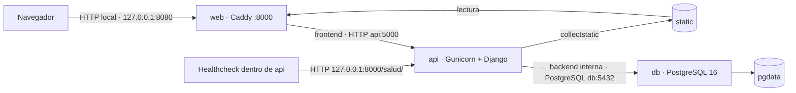
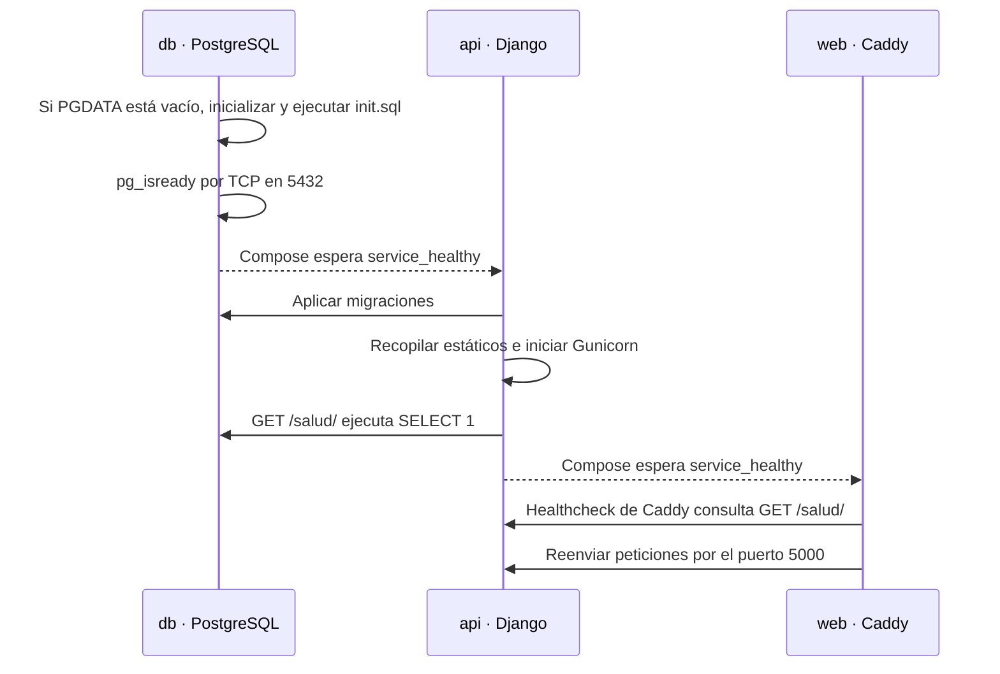

# Implementaciones realizadas

## v0.1.0 · Base de Melvin Edgardo Peña Caballero

La rama `feature/08-melvin-infraestructura` contiene el esqueleto compartido. `api/config` centraliza los ajustes, las rutas y WSGI. Las aplicaciones `cuentas`, `juego` y `estadisticas` viven en `api/` junto a las plantillas y los estáticos. La página inicial y la plantilla `base.html` son provisionales y usan la paleta Dark Neon de las maquetas.

Compose construye Django desde `api/Dockerfile` y Caddy desde `web/Dockerfile`, que incorpora `web/Caddyfile` en la imagen. PostgreSQL usa su imagen oficial y monta `db/init.sql` en modo de solo lectura.

### Servicios y comunicación



| Origen | Destino | Uso |
|---|---|---|
| Host local | `127.0.0.1:8080 → web:8000` | Acceso HTTP por Caddy. El puerto del host se cambia con `WEB_PORT`. |
| `web` | `api:5000` | Caddy reenvía las peticiones dinámicas por la red frontend. |
| Healthcheck de `api` | `127.0.0.1:8000` dentro de `api` | Gunicorn sirve la misma aplicación en loopback para consultar `/salud/`. |
| `api` | `db:5432` | Django consulta PostgreSQL por la red backend interna. 5432 es el puerto estándar de PostgreSQL. |

Caddy sirve `/static/` desde el volumen compartido en modo de solo lectura. Los dos usos de 8000 pertenecen a contenedores distintos. Caddy está conectado a frontend, Django a frontend y backend, y PostgreSQL a backend y a la red dedicada al acceso local de DBeaver. Los secretos se leen de `.env` y el proceso Django corre como usuario sin privilegios.

### Secuencia de arranque



`pg_isready` comprueba si PostgreSQL acepta conexiones. `/salud/` verifica además que Django puede ejecutar una consulta con sus credenciales. Si la consulta falla, responde HTTP 503. `depends_on` ordena el arranque inicial. El healthcheck propio de `web` consulta `http://127.0.0.1:8000/salud/` desde el contenedor de Caddy. Compose muestra `healthy` cuando responde la cadena Caddy → Django → PostgreSQL y `unhealthy` después de tres comprobaciones fallidas consecutivas fuera del período de arranque.

`db/init.sql` establece UTC como zona horaria predeterminada de la base del proyecto. La imagen oficial lo ejecuta únicamente al inicializar un volumen vacío. Las tablas de Django se crean con migraciones y los volúmenes existentes conservan su configuración.

### Cómo levantar los servicios en local

1. Inicia Docker y abre una terminal en la raíz del repositorio, donde está `compose.yaml`. Comprueba que el motor y Compose estén disponibles.

   ```sh
   docker info --format '{{.ServerVersion}}'
   docker compose version
   ```

2. Crea `.env` a partir de `.env.example` si aún no tienes uno.

   ```sh
   test -f .env || cp .env.example .env
   ```

   Edita `.env` y completa `POSTGRES_PASSWORD` y `DJANGO_SECRET_KEY` con valores distintos y aleatorios. Puedes ejecutar `openssl rand -hex 32` una vez para cada valor. Si PostgreSQL ya tiene un volumen inicializado, usa las credenciales vigentes. Si el puerto local 8080 está ocupado, cambia `WEB_PORT` y usa ese puerto en las URL.

3. Valida la configuración, construye las imágenes de `api` y `web` y levanta el proyecto.

   ```sh
   docker compose config --quiet
   docker compose up -d --build
   docker compose ps
   ```

   Compose espera a que `db` esté saludable antes de iniciar `api` y a que `api` esté saludable antes de iniciar `web`. Django aplica las migraciones y ejecuta `collectstatic` durante su arranque.

4. Verifica la aplicación a través de Caddy y ejecuta las pruebas.

   ```sh
   curl -fsS http://127.0.0.1:8080/salud/
   docker compose exec api python manage.py test
   ```

   La comprobación de salud debe devolver `{"estado": "ok"}`. Abre <http://127.0.0.1:8080/salud/> en el navegador para ver el panel de estado y <http://127.0.0.1:8080/> para ver la página inicial. Si algún servicio falla, consulta el estado con `docker compose ps -a` y los registros con `docker compose logs --tail=100 db api web`.

5. Para detener el entorno al terminar, ejecuta `docker compose down` desde la misma carpeta. El siguiente `docker compose up -d --build` reutilizará el volumen de PostgreSQL.

### Persistencia y límites iniciales

Para consultar PostgreSQL con DBeaver, `compose.yaml` publica `127.0.0.1:15432 → db:5432` y conecta `db` a una red bridge adicional para ese acceso. DBeaver se conecta desde el mismo equipo donde se ejecuta Docker, con host `127.0.0.1`, puerto `15432` y las credenciales de la base. Si se usa este Compose en Linux, el puerto queda limitado al loopback de ese servidor. Django sigue usando `db:5432` por la red backend interna.

Los servicios `db`, `api` y `web` usan `restart: unless-stopped`. Docker vuelve a iniciar un contenedor si su proceso principal termina y respeta las detenciones manuales. Un estado `unhealthy` por sí solo se refleja en el healthcheck y no activa esta política.

`buscaminas_g3_pgdata` guarda los datos de PostgreSQL. `docker compose down` retira los contenedores y las redes del proyecto. El siguiente `up` vuelve a montar el volumen. El volumen `buscaminas_g3_static` guarda archivos regenerables. Cambiar las credenciales en `.env` después de inicializar PostgreSQL requiere cambiar también las credenciales del rol en la base existente.

| Servicio | CPU | RAM | PID | Motivo |
|---|---:|---:|---:|---|
| db | 1.00 | 512 MiB | 100 | Dar margen a PostgreSQL y a las conexiones concurrentes. |
| api | 1.00 | 384 MiB | 64 | Gunicorn usa dos workers con dos hilos por worker. |
| web | 0.50 | 128 MiB | 48 | Caddy sirve estáticos y reenvía HTTP. |

Estos valores son un presupuesto inicial de 2.5 CPU y 1 GiB de RAM para los contenedores. Para ajustar los límites, medir latencia de las jugadas y consumo de CPU, memoria y PID durante la prueba de carga del juego integrado. El despliegue público con HTTPS en 80/443 corresponde al hito de Linux.

### Verificación de esta entrega

`docker compose config --quiet` aceptó la configuración. En el proyecto aislado `buscaminas_g3_verificacion` se construyeron las dos imágenes y arrancaron los tres servicios. La página inicial y `/salud/` respondieron por Caddy, PostgreSQL registró `TimeZone=UTC` y las tres pruebas Django pasaron con Python 3.12 y PostgreSQL 16. Tras `down` y `up`, PostgreSQL conservó su identificador de clúster y `/salud/` volvió a responder. Al terminar se retiraron los contenedores y las redes de verificación, conservando los volúmenes.

### Relevo al siguiente colaborador

Milton puede comenzar en `api/templates/base.html` y `api/templates/inicio_provisional.html` para implementar el layout y el inicio a partir de `docs/diseno/01_inicio.png`. Mantener los puntos de extensión de la plantilla o coordinar sus cambios por PR. Antes de trabajar en paralelo en el motor y el tablero, Emerson e Ismael deben cerrar el contrato del DTO y las respuestas de acciones repetidas.

Cada integrante debe añadir una entrada a este archivo en su PR. Incluir nombre, cambios por módulo, rutas, modelos o flujos afectados, verificación ejecutada, pendientes y una indicación concreta de dónde debe empezar el próximo colaborador. Dejar ese relevo actualizado en cada entrega.

### Vista de salud para el navegador

`/salud/` negocia el formato con la cabecera `Accept`. Cuando el cliente prefiere HTML, Django sirve `api/templates/salud.html` con un indicador verde de servicio operativo o uno rojo de servicio no disponible, el estado de PostgreSQL y un enlace para actualizar la comprobación. Docker y `curl` reciben el JSON habitual. Ambas representaciones conservan los códigos HTTP 200 y 503 y se sirven sin caché.

El panel muestra iconos y estados por servicio. `web` se verifica cuando la petición pasa por Caddy, que añade la cabecera interna `X-Buscaminas-Proxy`. `api` se verifica cuando Django genera la página y `db` cuando responde a `SELECT 1`. Si PostgreSQL falla, la página conserva el HTTP 503 y marca la fila de la base como `Unhealthy`. Las filas describen lo observado durante la petición. El healthcheck de Docker para `web` y `api` incluye la dependencia de PostgreSQL.

Cada fila muestra los puertos de escucha de su servicio. Caddy escucha en 8000 y el panel muestra además el host y puerto usados en la petición, normalmente `127.0.0.1:8080`. Django escucha en 5000 para Caddy y en 8000 dentro de su contenedor para el healthcheck. PostgreSQL escucha en 5432 por la red interna.

### Bitácora de IA

- Codex asistió en el esqueleto Django, la configuración de Compose y proxy, las pruebas de salud y esta documentación.

## Módulo de cuentas y perfil

Trabajo realizado en la rama personal `feature/08-melvin-infraestructura`. La distribución de integrantes se consulta en `docs/DISTRIBUCION_EQUIPO.md`.

| Ruta | Método | Comportamiento |
|---|---|---|
| `/` | GET | Inicio público de Milton. **Jugar** enlaza al login para visitantes y a la sección de juego para usuarios autenticados mientras se integra la selección de dificultad. |
| `/cuentas/registro/` | GET, POST | Valida usuario único, formato de correo y contraseña con los validadores de Django. Crea el usuario y su perfil en una transacción e inicia sesión. |
| `/cuentas/login/` | GET, POST | Autentica con usuario y contraseña. Después de iniciar sesión vuelve a la ruta local solicitada o abre el perfil. |
| `/cuentas/logout/` | POST | Cierra la sesión con protección CSRF y redirige a la pantalla de acceso. |
| `/perfil/` | GET, POST | Muestra el perfil del usuario autenticado y guarda alias, volúmenes de 0 a 100 y silencio. |

La migración `cuentas.0001_initial` crea `PerfilJugador` con una relación uno a uno al usuario de Django. Los perfiles de usuarios existentes se inicializan al abrir su perfil por primera vez. Compose aplica la migración al reconstruir e iniciar `api`.

Para probar el flujo, abre `/cuentas/registro/`, crea una cuenta, guarda las preferencias, cierra sesión y vuelve a entrar. Ejecuta `docker compose exec api python manage.py test cuentas` para verificar registro, sesión, CSRF, privacidad del perfil y persistencia.

En un proyecto Compose aislado pasaron las 14 pruebas de Django con PostgreSQL 16. La comprobación de migraciones quedó limpia y Caddy sirvió el formulario de registro y su hoja de estilos.

Las pantallas de acceso y perfil siguen las maquetas `02_acceso_usuarios.png` y `06_perfil.png`. Acceso y registro comparten cabecera, panel y pestañas. El perfil incorpora navegación por secciones, avatar, fecha de registro y controles de audio deslizantes con indicador de porcentaje. Los estilos y el script de volumen pertenecen a `api/cuentas/static/cuentas/`.

La pantalla de acceso en `/cuentas/login/` usa `01_inicio.png` como referencia. Integra el formulario Django en el panel de bienvenida y conserva la ilustración, los niveles, las características y el pie. El formulario admite nombre de usuario o correo asociado a una sola cuenta y permite alternar la visibilidad de la contraseña. En Chrome se comparó la vista de 1648 × 928 con la referencia y se verificó el ancho del documento a 390 y 360 px. Pasaron 16 pruebas de Django.

La portada de acceso y el registro comparten `api/cuentas/templates/cuentas/portada_acceso.html` y `portada.css`. Cada ruta renderiza sus campos Django y sus acciones. Se verificaron ambas pantallas a 1648, 390 y 360 px, incluido el control de visibilidad de cada contraseña.

El inicio de sesión apila sus campos. En ambos formularios, la acción principal ocupa todo el ancho y el acceso alternativo aparece como enlace de texto. El registro muestra errores por campo y conserva la validación de Django.

La ilustración de la portada se compone por capas en `api/cuentas/templates/cuentas/portada_mina.html`. El SVG recorta la mina de la imagen original y completa la pequeña zona del paisaje que queda visible al desplazarla. En `portada.css`, `--mina-ciclo-flotacion`, `--mina-ciclo-luz`, `--mina-altura` y `--mina-intensidad` controlan el efecto. Chrome confirmó el recorrido horario, los destellos secuenciales, el paisaje fijo y el movimiento reducido a 1648, 390 y 360 px.

La mina se reproduce automáticamente según la preferencia de movimiento del sistema. Si el navegador ya tenía una elección guardada, la portada la conserva al volver a abrir la página.

La portada de acceso y registro intenta reproducir en bucle la pista de `Musica/Musica_Login.mp4` al abrir la página. Si el navegador bloquea el arranque, el primer clic, toque o tecla vuelve a intentarlo. Caddy sirve la versión Opus y ofrece AAC como alternativa. El volumen inicial para visitantes es del 35 %.

Los enlaces **Regístrate** e **Inicia sesión** solicitan el formulario a Django y reemplazan solo esa sección. Conservan el reproductor y el SVG de la mina, actualizan la URL y permiten volver al formulario anterior desde el historial. Los formularios conservan su destino POST y el token CSRF. Sin JavaScript, los enlaces abren sus rutas con navegación normal.

Al entrar a `/perfil/`, la música cambia a `Musica_opciones`. Se reproduce en bucle con el volumen de música guardado y queda desactivada cuando el perfil está silenciado o el volumen es cero. La portada y el perfil comparten `api/cuentas/static/cuentas/musica.js`, que reintenta después de un gesto si el navegador bloquea la reproducción inicial.

Cada pantalla identifica su pista al incluir `cuentas/musica_fondo.html`. La portada de acceso y registro usa `musica-login` en el mismo reproductor. El perfil usa `musica-opciones`. Para integrar el juego, el colaborador debe indicar la pista de la pantalla previa a la partida y cambiar a la pista de partida cuando el juego confirme su inicio. Si ambos estados viven en la misma página, se debe sustituir la fuente del reproductor existente para que solo suene una pista. Ambos estados deben aplicar el volumen y el silencio del perfil.

La portada compacta los espacios en escritorios de menor altura y apila sus paneles en pantallas estrechas. El formulario de perfil guarda con el POST habitual de Django y actualiza las preferencias en la página sin reemplazar el reproductor. El volumen y el silencio guardados se aplican sobre la pista que está sonando.

La portada mide la altura visible y ajusta la escala cuando el contenido supera ese espacio. Recalcula el ajuste al cambiar el tamaño de la ventana o alternar entre acceso y registro. En Chrome se verificaron ambos formularios sin desplazamiento horizontal ni vertical en nueve tamaños, desde 360 × 640 hasta 1648 × 928.

En teléfonos, la portada oculta la bienvenida y Características, prioriza el formulario y coloca los niveles junto al pie. Los botones principales tienen texto más grande y una altura táctil de al menos 51 px en los tamaños de pantalla probados.

La vista móvil también oculta el pie técnico y los textos repetidos. La marca conserva el enlace a Inicio y el encabezado mantiene el acceso a Mi perfil. Los niveles quedan al borde inferior. En Chrome, los botones de acceso y registro midieron 58 px de alto con texto de 20 px a 360 × 640, 375 × 667 y 390 × 844, sin desplazamiento.

En teléfonos, la marca aparece una sola vez. La escena animada se centra encima del formulario y su paisaje se ensancha de forma independiente para cubrir el mismo ancho sin deformar la mina.

El perfil móvil usa una cabecera compacta, muestra la identidad antes de los accesos de sección y da más espacio táctil al alias, a los controles de audio y a **Guardar perfil**. En escritorio se conserva la navegación lateral.

Para el siguiente colaborador, Kenaliz puede leer las preferencias persistidas desde `request.user.perfil_jugador` una vez inicializado el perfil. Dimas puede conectar las estadísticas reales en `api/cuentas/templates/cuentas/perfil.html` cuando estén disponibles los modelos de partidas. La integración de las rutas privadas del juego y las respuestas 404 para partidas ajenas corresponde al motor. Cada colaborador debe registrar su verificación y dejar instrucciones para el siguiente relevo.

## Integración del motor y las pantallas

Se incorporó el PR #2 del motor y se conservaron las pantallas locales de inicio y resultado. **Jugar ahora** abre el tablero con la dificultad seleccionada. Si falta sesión, Django pasa por acceso y conserva el destino al iniciar sesión o registrar una cuenta. El tablero prepara la cuadrícula del nivel y el primer movimiento inicia la partida persistida.

Una acción, una consulta de tiempo o un abandono que devuelve un estado final incluye la URL de `/partidas/<uuid>/resultado/`. El resultado consulta la partida del usuario autenticado y toma el puntaje, duración, movimientos, banderas y tablero de PostgreSQL. La comparativa usa victorias previas del mismo jugador y nivel. Una partida ajena o en curso devuelve 404 en esta pantalla. `/inicio-juego/resultado-demo/` sigue disponible como demostración identificada.

Pasaron 42 pruebas de Django. En un Compose aislado se verificó en Chrome el recorrido desde Inicio, pasando por el acceso y el registro, hasta un tablero Normal de 100 casillas. Una jugada y el abandono llevaron al resultado de esa partida guardada. La pantalla de resultado se comprobó a 1600 y 390 px de ancho.

El historial y la clasificación quedan pendientes de sus módulos. El motor integrado crea partidas nuevas y todavía requiere una revisión separada de concurrencia para garantizar una única partida activa por usuario al abrir varias pestañas.
