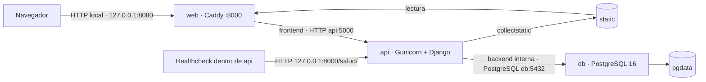
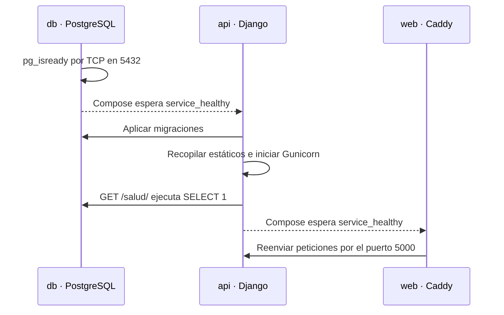

# Implementaciones realizadas

## v0.1.0 · Base de Melvin Edgardo Peña Caballero

La rama `feature/08-melvin-infraestructura` contiene el esqueleto compartido. `config` centraliza los ajustes, las rutas y WSGI. `cuentas`, `juego` y `estadisticas` están disponibles para sus responsables. La página inicial y la plantilla `base.html` son provisionales y usan la paleta Dark Neon de las maquetas.

### Servicios y comunicación

| Origen | Destino | Uso |
|---|---|---|
| Host local | `127.0.0.1:8080 → web:8000` | Acceso HTTP por Caddy. El puerto del host se cambia con `WEB_PORT`. |
| `web` | `api:5000` | Caddy reenvía las peticiones dinámicas por la red frontend. |
| Healthcheck de `api` | `127.0.0.1:8000` dentro de `api` | Gunicorn sirve la misma aplicación en loopback para consultar `/salud/`. |
| `api` | `db:5432` | Django consulta PostgreSQL por la red backend interna. 5432 es el puerto estándar de PostgreSQL. |

Caddy sirve `/static/` desde el volumen compartido en modo de solo lectura. Los dos usos de 8000 pertenecen a contenedores distintos. Caddy está conectado únicamente a frontend, PostgreSQL únicamente a backend y Django a ambas. Solo Caddy declara una publicación de puerto. Los secretos se leen de `.env` y el proceso Django corre como usuario sin privilegios.

### Secuencia de arranque

`pg_isready` comprueba si PostgreSQL acepta conexiones. `/salud/` verifica además que Django puede ejecutar una consulta con sus credenciales. Si la consulta falla, responde HTTP 503. `depends_on` ordena el arranque inicial. Si PostgreSQL deja de responder después, Caddy puede seguir en ejecución y `/salud/` reflejará el fallo.

### Persistencia y límites iniciales

`buscaminas_g3_pgdata` guarda los datos de PostgreSQL. `docker compose down` retira los contenedores y las redes del proyecto. El siguiente `up` vuelve a montar el volumen. El volumen `buscaminas_g3_static` guarda archivos regenerables. Cambiar las credenciales en `.env` después de inicializar PostgreSQL requiere cambiar también las credenciales del rol en la base existente.

| Servicio | CPU | RAM | PID | Motivo |
|---|---:|---:|---:|---|
| db | 1.00 | 512 MiB | 100 | Dar margen a PostgreSQL y a las conexiones concurrentes. |
| api | 1.00 | 384 MiB | 64 | Gunicorn usa dos workers con dos hilos por worker. |
| web | 0.50 | 128 MiB | 48 | Caddy sirve estáticos y reenvía HTTP. |

Estos valores son un presupuesto inicial de 2.5 CPU y 1 GiB de RAM para los contenedores. Para ajustar los límites, medir latencia de las jugadas y consumo de CPU, memoria y PID durante la prueba de carga del juego integrado. El despliegue público con HTTPS en 80/443 corresponde al hito de Linux.

### Verificación de esta entrega

`docker compose config --quiet` aceptó la configuración con valores de prueba. `manage.py check` y las dos pruebas HTTP de salud sin base activa pasaron con Python 3.13 local. La imagen declara Python 3.12. El daemon de Docker estaba apagado durante la revisión. Quedan pendientes el arranque del stack, la prueba de salud con PostgreSQL real y la comprobación de persistencia tras `down` y `up`.

### Relevo al siguiente colaborador

Milton puede comenzar en `templates/base.html` y `templates/inicio_provisional.html` para implementar el layout y el inicio a partir de `docs/diseno/01_inicio.png`. Mantener los puntos de extensión de la plantilla o coordinar sus cambios por PR. Antes de trabajar en paralelo en el motor y el tablero, Emerson e Ismael deben cerrar el contrato del DTO y las respuestas de acciones repetidas.

Cada integrante debe añadir una entrada a este archivo en su PR. Incluir nombre, cambios por módulo, rutas, modelos o flujos afectados, verificación ejecutada, pendientes y una indicación concreta de dónde debe empezar el próximo colaborador. Dejar ese relevo actualizado en cada entrega.

### Bitácora de IA

- Codex asistió en el esqueleto Django, la configuración de Compose y proxy, las pruebas de salud y esta documentación.
